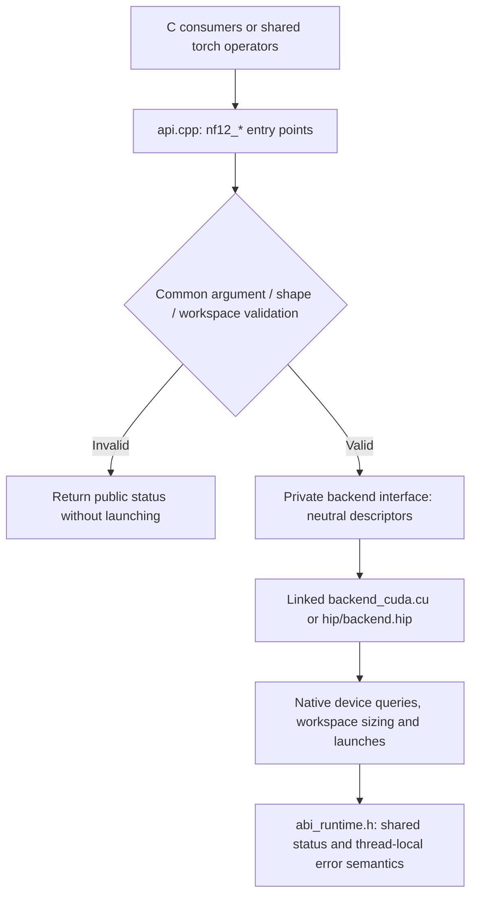

# Shared C ABI and native backends

CUDA and HIP compile the same `csrc/api.cpp` and `csrc/status.cpp` into their
native libraries. `include/nf12/nf12.h` retains the public function signatures,
status values and descriptor layouts. `csrc/torch/ops.cpp` and the Python API
remain shared and unchanged.

The backend is selected at build/link time. There is no per-call vendor
inference, dispatch registry, additional device allocation or global lock.
The shared frontend uses plain pointers and integer metadata; adapters convert
them to native CUDA/HIP types. Backend-private argument structures are not part
of the exported C ABI and are not consumed by vLLM's NF12 integration.

Shape bounds, alignment, empty-input behavior, packed byte counts, workspace
validation and error precedence now have one implementation. Workspace **sizes**,
capability decisions, tile selection and launches remain backend-specific.
The HIP adapter retains full/tail workspace sizing and large-M chunking; the
CUDA adapter delegates to its existing native launch planners. Backend limits
return an unsupported status rather than narrowing an expert count unsafely.

Raw C callers still supply scratch storage. Torch callers still obtain local
scratch from the caching allocator. Streams pass through unchanged; an empty
routing call still zeros offsets on the supplied stream. No mutable workspace
is shared across calls. Native runtime error state is thread-local, persists
across successful calls, and is not overwritten by codec validation or device
capability rejection. Grouped expert counts above INT32_MAX are rejected as
invalid before either backend is called.

The native `nf12_hip.h` entry points remain available. The single-token fused
MoE C++ boundary also retains its existing interface and implementations.

## Compatibility checks

- The public `nf12.h`, Python layer and torch operators are unchanged.
- The C99 consumer invokes all public C functions on each backend.
- Export checks verify the shared C symbol set.
- `tests/api/test_abi_contract.py` checks C and ctypes descriptor sizes and
  offsets against fixed LP64 baselines, plus error categories and thread isolation.
- Existing suites cover exact BF16t outputs, packed bytes, padded strides,
  invalid/empty inputs, workspace bounds, streams, GIL=0 and graph replay.

The bridge shrinks from 975 to 841 lines across its implementation and private
headers. The backend-specific copies of public validation and entry points are
removed rather than wrapped in another forwarding layer.

Validation on the final shared frontend: **611 passed** on R9700 and **445
passed** on RTX 4090, using GIL=0 and two visible devices. There were 12/13
backend-dependent skips respectively, plus the known PR #7 case deselected
in both runs. All four new ABI contract tests ran on both backends.
